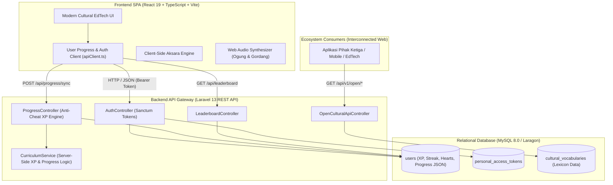

# 🧣 BATAKGO • Parsiajaran Hata Batak Interaktif

> **Karya Web Development Competition UINIC 8.0 (2026)**  
> **Penyelenggara:** HMPS Informatika UIN Sunan Kalijaga Yogyakarta  
> **Tema Kompetisi:** *"Engineering Interconnected Web Solutions to Empower Digital Ecosystems"*  
> **Subtema SDGs:** Pendidikan Bermutu (SDG 4) & Pelestarian Warisan Budaya Nusantara.

---

## 📖 Tentang BATAKGO

**BATAKGO** adalah platform edukasi interaktif berbasis web yang memadukan gamifikasi modern ala *Duolingo* dengan kekayaan warisan budaya Batak Toba. Bersama maskot legendaris **Gale (Sigale-gale)** berbusana tenun Ulos tradisional, BATAKGO menghadirkan pengalaman belajar bahasa daerah yang adiktif, inklusif, dan berteknologi tinggi.

Platform ini tidak hanya melayani pembelajaran bagi siswa (*end-user*), melainkan bertindak sebagai **Interconnected Cultural Hub** pertama yang menyediakan **Open RESTful API** bagi ekosistem digital nasional yang ingin mengintegrasikan leksikon bahasa Batak, transliterasi Surat Batak (Unicode ISO 15924), dan kalkulasi kekerabatan *Dalihan Na Tolu*.

---

## 🌟 Fitur Unggulan

1. **🎮 Gamified Curriculum Path (Tiga Bolit Cultural Design)**
   - Jalur belajar terstruktur (*Units 1–5 & Lessons*) dengan tata letak kurikulum terpadu.
   - Sistem nyawa tradisional **Tondi** (5 nyawa yang dapat dipulihkan secara instan).
   - Akumulasi skor **Gordang XP** dengan pengamanan server-side anti-farming.
   - Efek suara instrumen tradisional Batak (*Web Audio API* sintetis: Ogung Gong & Gordang Sambilan).

2. **🤝 Interlocking Kinship Engine (Partuturan Dalihan Na Tolu)**
   - Kalkulator sapaan kekerabatan otomatis antar penutur Batak berdasarkan jenis kelamin dan hubungan darah (*Somba Marhula-hula, Manat Mardongan Tubu, Elek Marboru*).

3. **📜 Surat Batak Transliteration Engine (Unicode ISO 15924)**
   - Konversi teks alfabet Latin ke Aksara Batak Toba (Unicode range `U+1BC0`–`U+1BFF`) secara silabis, akurat dengan tanda diakritik *Ina ni Surat* dan *Anak ni Surat* (Hatadingan, Ulu, Haborotan, Siala Hanapi, Haminsaran, Hajoringan, dan Pangolat).

4. **🏆 Live Multi-User Leaderboard (MySQL Relational Database)**
   - Papan skor terhubung langsung ke basis data relasional MySQL via backend Laravel 13, memperingkatkan pembelajar di seluruh nusantara secara *real-time*.

5. **🧣 Lemari Tenun Ulos Tradisional**
   - Ensiklopedia interaktif Ulos (Ulos Mangiring, Ragidup, Ragi Hotang, Sadum, Sibolang, dan Bintang Maratur) yang terbuka secara otomatis saat menyelesaikan modul unit.

6. **🌐 BATAKGO Open Cultural Knowledge API (Interconnected Web Ecosystem)**
   - Menjawab tema utama UINIC 8.0, menyediakan RESTful API publik bagi ekosistem pengembang aplikasi:
     - `GET /api/v1/open/dictionary`: Kamus leksikon Batak-Indonesia terbuka (pencarian leksikal, kategori, fonetik, silabel, contoh kalimat).
     - `GET /api/v1/open/partuturan`: API kalkulasi panggilan kekerabatan adat.
     - `GET /api/v1/open/aksara`: API transliterasi Aksara Batak terbuka.

---

## 🏗️ Arsitektur Sistem

BATAKGO dibangun dengan arsitektur **Decoupled Client-Server (REST API)** yang mengutamakan integritas data, keamanan, dan skalabilitas:



### 📁 Struktur Direktori Terpisah (Clean Monorepo Separation)

Proyek ini telah dipisahkan secara modular dan rapi ke dalam dua domain utama:

```
BATAKGO/
├── 📁 backend/                    # Domain Backend (Laravel 13 API & MySQL)
│   ├── app/                       # Logika Bisnis, Controllers, Models, & Services
│   │   ├── Http/Controllers/      # Auth, Progress, Leaderboard, OpenCulturalApi
│   │   ├── Models/                # User, CulturalVocabulary
│   │   └── Services/              # CurriculumService (Anti-cheat XP & canonical validation)
│   ├── routes/api.php             # REST API Endpoints v1
│   ├── database/                  # Migrations & Cultural Seeders
│   ├── tests/Feature/             # PHPUnit Automated Test Suites
│   └── artisan                    # Laravel CLI Entry Point
│
├── 📁 frontend/                   # Domain Frontend (React 19 + TypeScript + Vite)
│   ├── src/                       # Komponen UI, Gamifikasi, & Utilitas Budaya
│   │   ├── components/            # Views (Learn, Kamus, Partuturan, Aksara, Leaderboard, Ulos)
│   │   └── utils/                 # AudioSynthesizer, AksaraBatak, BatakData, ApiClient
│   ├── public/                    # Aset statis & audio
│   ├── tests/                     # Vitest/TSX Unit Tests (Aksara Unicode & Kurikulum)
│   ├── index.html                 # Entry Point HTML SPA
│   ├── vite.config.ts             # Konfigurasi Vite & Tailwind CSS
│   └── package.json               # Dependensi & script khusus frontend
│
├── package.json                   # Root Orchestrator (npm run dev/build/test otomatis delegasi)
└── README.md                      # Dokumentasi Proyek & Panduan Pengujian
```

---

## 🔒 Keamanan & Integritas Data (Anti-Cheat System)

1. **Server-Side Authoritative XP Calculation**:
   Klien tidak dapat memalsukan perolehan skor XP dengan mengirimkan angka acak. Backend memverifikasi ID pelajaran terhadap `CurriculumService` kanonis dan hanya menganugerahkan nilai XP resmi.
2. **Anti-Duplicate XP Farming**:
   Pelajaran yang sudah pernah diselesaikan ditandai dalam basis data. Upaya berulang mengirim penyelesaian pelajaran yang sama akan menghasilkan `xp_awarded = 0`.
3. **Validasi ID Kanonis (*Kebab-Case*)**:
   Semua ID unit (`unit-1`–`unit-5`), lesson (`u1-l1`–`u5-l1`), dan ulos (`ulos-mangiring`, dll.) dinormalisasi otomatis untuk mencegah desinkronisasi antara SQLite testing, MySQL produksi, dan antarmuka klien.
4. **Token-Based Stateless Authentication**:
   Menggunakan Laravel Sanctum dengan personal access tokens, aman dari celah CSRF pada arsitektur decoupled SPA.
5. **Sanitasi Input & SQL Injection Prevention**:
   Semua kueri pencarian kamus dan kalkulator partuturan menggunakan PDO Prepared Statements dan Eloquent ORM.

---

## 🚀 Panduan Menjalankan Proyek Secara Lokal

### Prasyarat:
- **PHP >= 8.2** (Sudah tersedia di Laragon)
- **Composer** (Sudah tersedia di Laragon)
- **Node.js >= 18** & **npm**
- **MySQL Database Server** (Jalankan via Laragon *"Start All"*)

---

### Langkah 1: Menjalankan Backend Laravel API

1. Masuk ke direktori backend:
   ```bash
   cd backend
   ```
2. Pastikan file `.env` terkonfigurasi ke database MySQL `batakgo_db`:
   ```env
   DB_CONNECTION=mysql
   DB_HOST=127.0.0.1
   DB_PORT=3306
   DB_DATABASE=batakgo_db
   DB_USERNAME=root
   DB_PASSWORD=
   ```
3. Jalankan migrasi dan seeding leksikon budaya lengkap:
   ```bash
   php artisan migrate --seed
   ```
4. Jalankan server Laravel backend (Port 8000):
   ```bash
   php artisan serve
   ```
   *Backend API siap melayani di: `http://127.0.0.1:8000`*

---

### Langkah 2: Menjalankan Frontend React

Tersedia dua opsi yang fleksibel:

**Opsi A (Dari Root Folder):**
```bash
npm run dev
```

**Opsi B (Dari Folder Frontend):**
```bash
cd frontend
npm run dev
```

Buka peramban (*browser*) di tautan:
```
http://localhost:3000
```

---

## 🧪 Pengujian Otomatis (Automated Testing)

### 1. Backend Feature Tests (Laravel PHPUnit)
```bash
cd backend
php artisan test --filter=BatakGoApiTest
```

**Hasil Pengujian:**
```
✓ test_api_health_check
✓ test_user_can_register_and_receive_canonical_data
✓ test_login_with_valid_and_invalid_credentials
✓ test_auth_me_protected_endpoint
✓ test_sync_progress_awards_canonical_xp_on_first_completion
✓ test_sync_progress_prevents_duplicate_xp_farming
✓ test_sync_progress_rejects_invalid_lesson_id
✓ test_automatic_unit_unlocking_when_all_unit_lessons_completed
✓ test_refill_hearts_endpoint
✓ test_leaderboard_endpoint
✓ test_open_cultural_api_dictionary
✓ test_open_cultural_api_partuturan
✓ test_open_cultural_api_aksara_accurate_unicode

Tests:    13 passed (50 assertions)
Duration: ~7.0s
```

### 2. Frontend Unit Tests (Node.js Test Runner)
```bash
npm test
```

**Hasil Pengujian:**
```
▶ Aksara Batak Unicode Transliteration Tests
  ✔ correctly maps Horas into authentic Batak Unicode (ᯂᯬᯒᯘ᯳)
  ✔ correctly maps Batak into authentic Batak Unicode (ᯅᯖᯂ᯳)
  ✔ correctly maps Toba into authentic Batak Unicode (ᯖᯬᯅ)
  ✔ correctly handles punctuation with Bindu symbols
✔ Aksara Batak Unicode Transliteration Tests
▶ Curriculum Data Integrity Tests
  ✔ all units have canonical kebab-case IDs (unit-X)
  ✔ all lessons have canonical kebab-case IDs (uX-lY)
✔ Curriculum Data Integrity Tests

Tests: 6 passed (6/6)
```

### 3. Production Build & Typecheck
```bash
npm run lint  # tsc --noEmit: 0 error
npm run build # Vite production bundle: built in ~1.2s
```

---

## 📚 Dokumentasi Open Cultural Knowledge API

Endpoint publik yang dapat diakses oleh ekosistem web pihak ketiga:

| Method | Endpoint | Deskripsi | Parameter Query |
| :--- | :--- | :--- | :--- |
| `GET` | `/api/health` | Health check backend | - |
| `GET` | `/api/leaderboard` | Live Multi-User Leaderboard | `Authorization: Bearer <token>` (opsional) |
| `GET` | `/api/v1/open/dictionary` | Pustaka kata Batak Toba | `q` (kata kunci), `category` (`sapaan`, `keluarga`, `angka`, `makanan`, `budaya`, `sifat`) |
| `GET` | `/api/v1/open/partuturan` | Kalkulator kekerabatan adat | `my_gender` (`male`/`female`), `relation` (`saudara_laki_ibu`, `saudara_perempuan`, dll.) |
| `GET` | `/api/v1/open/aksara` | Transliterasi Surat Batak ISO 15924 | `text` (contoh: `horas`, `batak`, `toba`) |

### Contoh Pemanggilan Aksara API:
```bash
curl -X GET "http://localhost:8000/api/v1/open/aksara?text=horas"
```
**Respon JSON:**
```json
{
  "status": "success",
  "api_version": "v1.0",
  "latin_text": "horas",
  "aksara_batak": "ᯂᯬᯒᯘ᯳",
  "unicode_range": "U+1BC0..U+1BFF (Batak Script Standard ISO 15924)"
}
```

---

## 📜 Lisensi & Tim Pengembang
Hak cipta proyek sepenuhnya milik Tim Pengembang **BATAKGO** © 2026 untuk keikutsertaan dalam **UIN Informatic Competition (UINIC) 8.0**, HMPS Informatika Universitas Islam Negeri Sunan Kalijaga Yogyakarta.

*Horas ma di hita saluhutna!*
